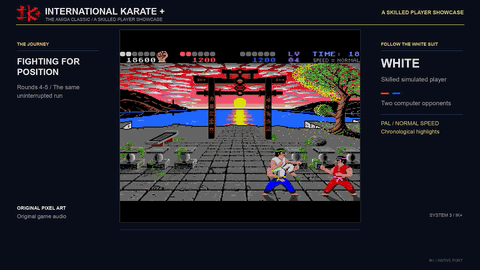
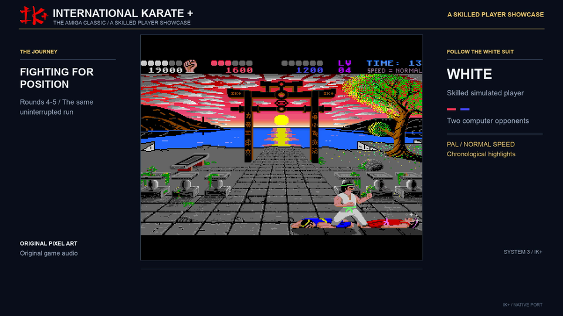
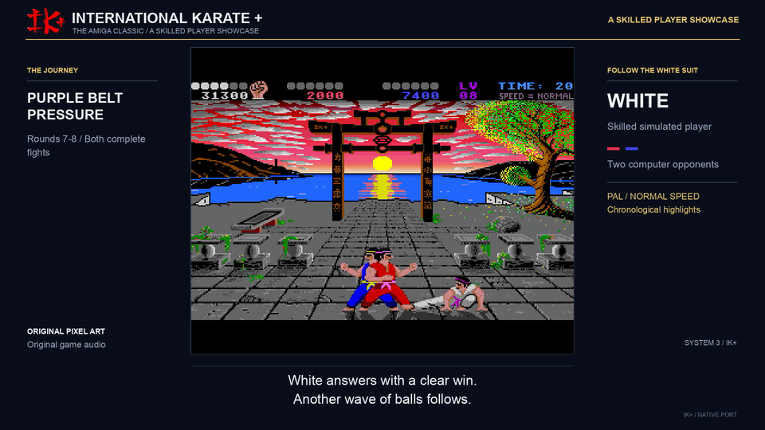
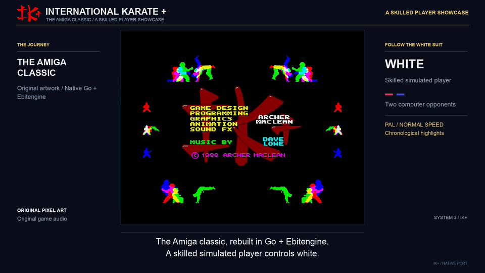
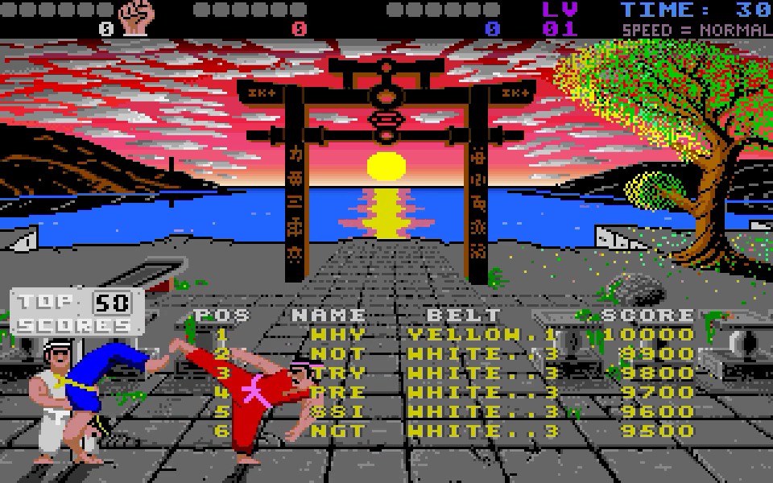

# IK+ Go

A native Go/Ebitengine remake of **International Karate +** for desktop and
Android. Three fighters compete in the original arena through ranked rounds,
bonus stages, score tables and the animated title sequence.



[Watch the current campaign and high-score presentation](media/ikplus-presentation.webm)

| Fight | Ball bonus |
| --- | --- |
|  |  |

| Title presentation | High scores |
| --- | --- |
|  |  |

## Desktop

Go 1.26 or newer and a desktop graphics environment are required.

```sh
go run .
make build
./bin/ikplus
```

Useful launch options:

```sh
go run . -fullscreen -scale 4
go run . -bonus 1       # Ball-and-shield practice.
go run . -bonus 2       # Bomb practice.
go run . -touch         # Preview Android controls.
go run . -autoplay      # Watch an uninterrupted native campaign.
```

## Controls

| Input | Action |
| --- | --- |
| F1 / F2 | Start one / two players |
| Arrow keys + Space or right Ctrl | White fighter movement and Fire |
| WASD + left Shift | Red fighter movement and Fire |
| Standard gamepad stick / D-pad + primary button | Move and Fire |
| P / Pause / gamepad Start | Pause or resume |
| F3 / F4 | Toggle music / effects |
| Minus / Equal or keypad -/+ | Music volume |
| F6–F10 | Turbo, fast, normal, slow and slowest speed |
| 8 | Cycle scenery colours |
| S | Toggle the ground shade in two-player play |
| J | Toggle the referee variant |
| H | Open the move reference |
| M | Toggle all output audio |
| Escape / Android Back | Pause, close a screen or return to the title |
| F11 | Toggle fullscreen |
| Q on the desktop title | Quit |

Directions choose the first eight actions. Hold Fire with a direction for the
second set of moves. The map mirrors automatically when a fighter changes side.
The original typed options such as `GERM`, `UK`, `FREZ`, `FAST`, `PACI`,
`FISH`, `BIRD`, `PERI`, `FILT` and `TITL` are also supported.

## Android

```sh
make android
make android-run
```

The APK is written to `android/app/build/outputs/apk/debug/app-debug.apk`.
The landscape layout keeps the original picture and places the movement stick,
Fire, Pause, Menu and Sound controls in side panels. Lifecycle interruptions
pause play and release held touches.

## Rebuilding the game data

The generated game resources are included, while the source ADF is not. See
[the asset recovery guide](docs/asset-extraction.md) to reproduce them from your
own compatible disk.

## Original game credits

International Karate + was created by Archer Maclean and published by System 3.
The original name, program, graphics, music, audio and game data remain the
property of their respective copyright holders. This independent fan remake is
not affiliated with or endorsed by the original rights holders.

